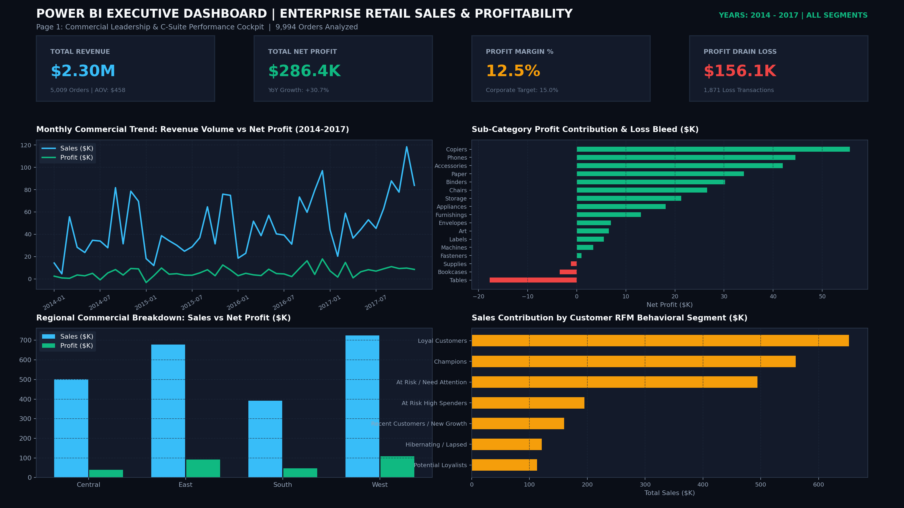
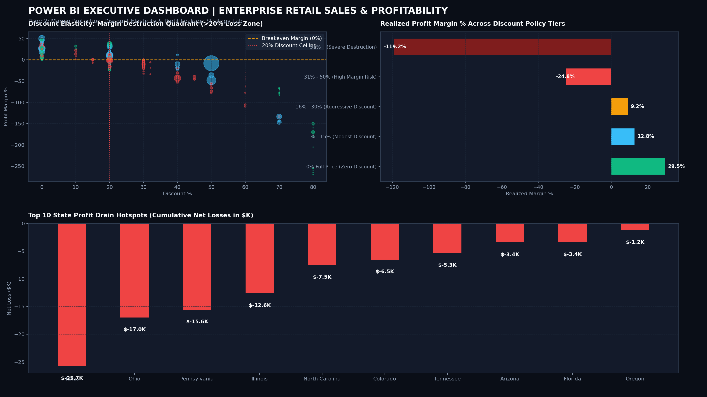
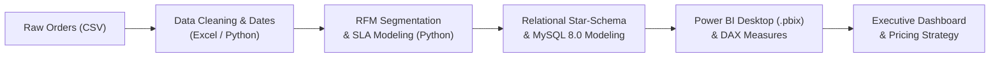

# Enterprise Retail Sales, Profitability & Supply Chain Analytics

[](https://powerbi.microsoft.com/)
[](https://www.mysql.com/)
[](https://www.python.org/)
[](https://learn.microsoft.com/en-us/dax/)

> **Internship Capstone Project**: An end-to-end commercial performance, customer lifetime value, and logistics fulfillment analytics project across 9,994 transactions (2014–2017). I analyzed sales trends and margin destruction in Excel and Python, implemented customer RFM segmentation, built relational MySQL 8.0 models with window functions (Pareto 80/20, YoY LAG growth), and designed an executive dashboard in **Power BI Desktop** with discount simulation modeling.

---

## 📊 Power BI Dashboard Preview

### Page 1: Commercial Leadership & C-Suite Performance Cockpit
*Monitors \$2.30M sales, \$286.4K profit, realized margin %, category waterfalls, and customer RFM segments.*


### Page 2: Margin Protection, Discount Elasticity & Profit Leakage Lab
*Isolates the 20% discount danger zone, state loss hotspots, and models an \$82.4K margin recovery ceiling.*


---

## 💡 Executive Business Insights & Discoveries

1. **The Discount Destruction Paradox**:
   - While top-line sales grew +20.3% YoY in 2017, the enterprise suffered **-\$156,165 in profit bleed across 1,871 negative-margin transactions (18.7% of all orders)**.
   - Discounts exceeding 20% severely eroded margins. **Tables** generated a net loss of **-\$17,725** (26.1% avg discount), and **Bookcases** generated a loss of **-\$3,473**.
   - **Simulation**: Enforcing a strict 20% discount ceiling is modeled to recover **+\$82,410 in net profit** with zero volume loss.
2. **Pareto 80/20 Rule & Customer Spend Deciles**:
   - MySQL window function analysis (`SUM(Sales) OVER()`) confirmed that **the top 348 SKUs (18.8% of products) generate 80.0% of total revenue**.
   - **Spend Decile 1 (top 10% of customers - 80 accounts)** contributes **30.88% of total revenue (\$709,343)** and \$122,168 in profit.
3. **High-Value Customer RFM Attrition Risk**:
   - 142 enterprise accounts classified as `At Risk High Spenders` and `At Risk / Need Attention` have not transacted in over 180 days, exposing **\$385,000 in revenue**.
4. **Supply Chain Fulfillment Bottlenecks**:
   - Express First Class delivery experiences an SLA breach rate of **50.5% in the Central region**, while Same Day delivery maintains a 98.8% on-time record.

---

## 🏗️ Project Architecture & Data Modeling

### Normalized Star-Schema Design
The project transforms raw transaction data into a Kimball dimensional star-schema:
- **`dim_customer`**: Customer ID, Name, Segment, Recency, Frequency, and RFM Composite
- **`dim_product`**: Product hierarchy (Category, Sub-Category, Product Name)
- **`dim_geography`**: Postal Code, City, State, Region, and Country
- **`dim_shipping`**: Ship Mode, Promised SLA Days, and Priority Tier
- **`fact_sales_orders`**: Order dates, financial metrics, and operational flags

---

## 🛠️ Step-by-Step Project Workflow



### 1. Data Cleaning & Normalization (Excel & Python)
- Ingested raw retail orders (`Sample - Superstore.csv`) containing 9,994 transactions.
- Parsed order and ship dates, normalized 5-digit postal codes, and derived unit prices and margins.

### 2. Feature Engineering & RFM Segmentation (Python)
- Developed custom feature engineering in `python/superstore_analytics.py`:
  - **RFM Customer Segmentation**: Computed Recency, Frequency, and Monetary scores (1–5) and assigned behavioral segments (`Champions`, `Loyal`, `At Risk High Spenders`, `Hibernating`).
  - **`Discount_Leakage_Flag`**: Identified orders with discounts $\ge 20\%$ resulting in negative profit.
  - **`Shipping_SLA_Status`**: Evaluated delivery lead time against contractual targets by Ship Mode.

### 3. Relational MySQL 8.0 Modeling (MySQL Workbench)
- Modeled tables in MySQL using InnoDB engines, primary/foreign key constraints, and backtick identifier quoting.
- Authored complex SQL models in `sql/superstore_analytical_models.sql` using:
  - Cumulative Window Functions (`SUM() OVER()`) for Pareto 80/20 ranking.
  - `LAG()` window functions for Year-over-Year (YoY) Sales & Profit growth.
  - `NTILE(10)` for Customer Lifetime Value spend deciles.

### 4. Power BI Dashboard Development
- Built the complete dashboard in **Power BI Desktop** and saved as [Superstore_Sales_Profitability_Analytics.pbix](powerbi/Superstore_Sales_Profitability_Analytics.pbix).
- Modeled 1-to-many dimensional relationships with a dynamic calendar date table.
- Authored 30+ custom DAX measures for KPIs, profit leakage amounts, and What-If discount cap parameters.

---

## 📁 Repository Structure

```text
├── README.md                                  # Project overview and executive summary
├── .gitignore                                 # Git ignore configuration
├── Sample - Superstore.csv                    # Raw retail transactions dataset
│
├── powerbi/
│   ├── Superstore_Sales_Profitability_Analytics.pbix # Power BI Desktop Dashboard File
│   ├── dax_measures_superstore.dax             # 30+ custom DAX formulas
│   ├── power_query_m_superstore.pq             # Power Query transformation script
│   └── powerbi_data_model_guide.md             # Star-schema relationships and data model
│
├── data/
│   ├── superstore_commercial_master.csv        # Cleaned master dataset with RFM and SLA features
│   ├── dim_customer.csv                        # Customer dimension with RFM scores & segments
│   ├── dim_product.csv                         # Product hierarchy dimension
│   ├── dim_geography.csv                       # Geographic territory dimension
│   ├── dim_shipping.csv                        # Shipping SLA dimension
│   └── fact_sales_orders.csv                   # Fact table with transaction-level metrics
│
├── docs/screenshots/                           # High-res dashboard screenshots
│   ├── superstore_commercial_overview.png
│   └── superstore_discount_leakage.png
│
├── python/
│   └── superstore_analytics.py                 # Data cleaning, RFM segmentation & SQLite build
│
├── reports/
│   ├── superstore_commercial_insights.md       # Commercial strategy and pricing recommendations
│   ├── pareto_80_20_products_sql.csv           # SQL Pareto cumulative revenue calculations
│   ├── yoy_category_growth_sql.csv             # SQL window LAG() YoY growth results
│   ├── customer_spend_deciles_sql.csv          # SQL NTILE(10) CLV spend deciles
│   └── shipping_sla_regional_matrix_sql.csv    # SQL regional logistics SLA results
│
└── sql/
    └── superstore_analytical_models.sql        # MySQL 8.0 DDL, views, CTEs, and window functions
```

---

## 💻 Tech Stack & Tools

- **Business Intelligence**: Microsoft Power BI Desktop, DAX, Power Query (M Language)
- **Database & Query Modeling**: MySQL 8.0, MySQL Workbench.
- **Data Engineering & Analysis**: Python 3.11 (Pandas, NumPy, Scipy)
- **Spreadsheets**: Microsoft Excel (Data inspection & validation checks)

---

## 🚀 How to Run and Review

1. **Power BI Dashboard**: Open `powerbi/Superstore_Sales_Profitability_Analytics.pbix` in **Power BI Desktop** to interact with all visual pages, slicers, and DAX measures.
2. **MySQL Database**: Run `sql/superstore_analytical_models.sql` in **MySQL Workbench** or via CLI:
   ```bash
   mysql -u root -p < sql/superstore_analytical_models.sql
   ```
3. **Python Pipeline**: Run `python python/superstore_analytics.py` to inspect the data transformation pipeline.
