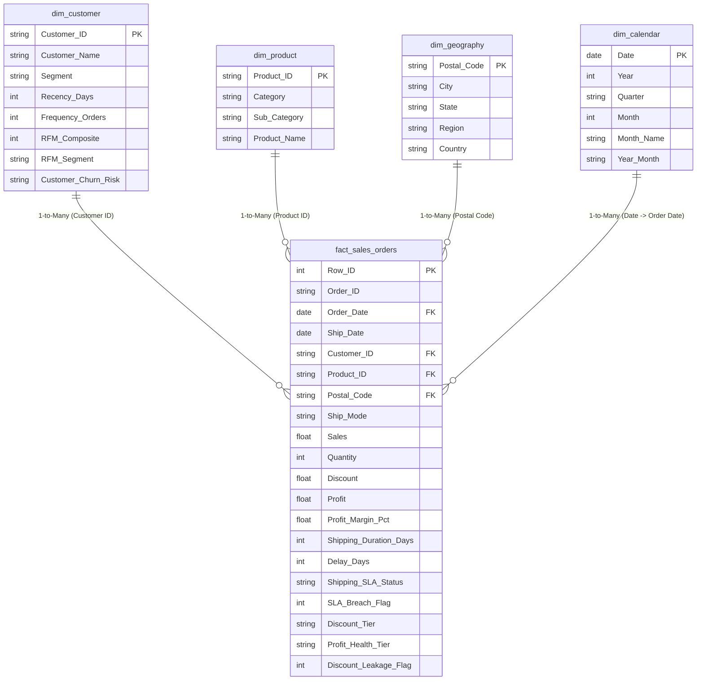

# Power BI Data Model Architecture Guide
## Project 2: Enterprise Retail Sales, Profitability & Supply Chain Analytics

### 1. Architectural Schema Design (Star-Schema)
The architecture follows Kimball dimensional modeling best practices for commercial retail analytics:

### 2. Relationship Cardinality & Filter Direction
| Primary / Foreign Key | Dimension Table | Fact Table | Cardinality | Cross Filter Direction |
| :--- | :--- | :--- | :--- | :--- |
| `Customer ID` | `dim_customer` | `fact_sales_orders` | 1-to-Many (1:*) | Single (Dimension filters Fact) |
| `Product ID` | `dim_product` | `fact_sales_orders` | 1-to-Many (1:*) | Single (Dimension filters Fact) |
| `Postal Code` | `dim_geography` | `fact_sales_orders` | 1-to-Many (1:*) | Single (Dimension filters Fact) |
| `Date` -> `Order Date` | `dim_calendar` | `fact_sales_orders` | 1-to-Many (1:*) | Single (Date filters Fact) |

### 3. Hierarchies Configured
1. **Product Hierarchy**:
   - Level 1: `Category` (Furniture, Office Supplies, Technology)
   - Level 2: `Sub-Category` (17 sub-categories)
   - Level 3: `Product Name` (1,850 SKUs)
2. **Geographic Hierarchy**:
   - Level 1: `Country` (United States)
   - Level 2: `Region` (Central, East, South, West)
   - Level 3: `State` (49 States)
   - Level 4: `City`
   - Level 5: `Postal Code`
3. **Date Drill Hierarchy**:
   - `Year` -> `Quarter` -> `Month Name` -> `Date`

### 4. Implementation Steps in Power BI Desktop
1. Open **Power BI Desktop**.
2. Click **Transform Data** to open Power Query Editor.
3. Open **Advanced Editor** and paste the code from [power_query_m_superstore.pq](file:///D:/SP/Project2_Superstore_Analytics/powerbi/power_query_m_superstore.pq).
4. Mark `dim_calendar` as the official Date Table.
5. In Model View, configure the star schema relationships per table above.
6. Create measure folders and import all DAX formulas from [dax_measures_superstore.dax](file:///D:/SP/Project2_Superstore_Analytics/powerbi/dax_measures_superstore.dax).
