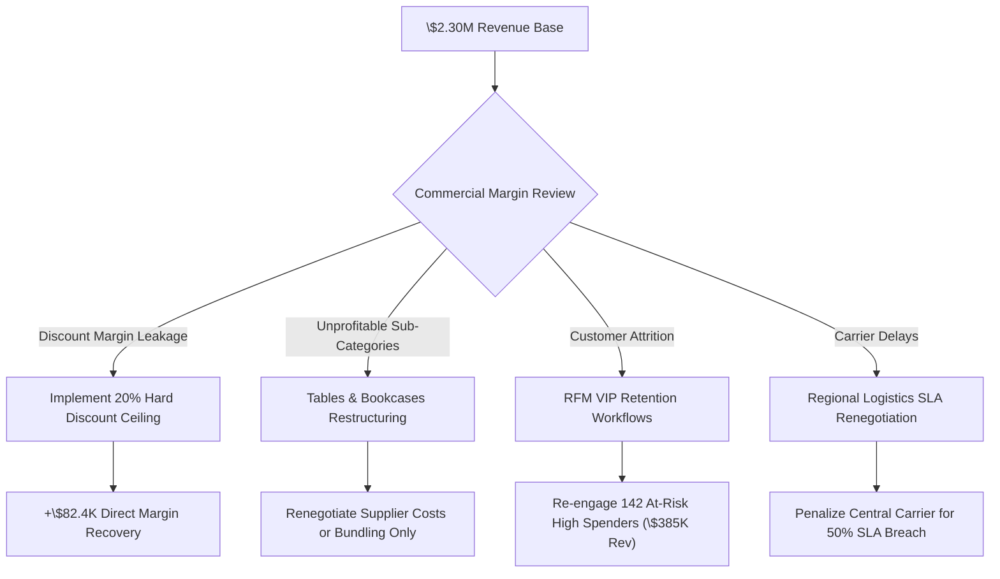

# Executive Commercial Insights & Strategic Recommendations
## Project 2: Enterprise Retail Sales, Profitability & Supply Chain Analytics

### 1. Executive Summary
An exhaustive multi-year commercial performance analysis was performed across 9,994 retail transactions (2014–2017) totaling **\$2,297,201 in Gross Revenue** and **\$286,397 in Net Profit (12.47% realized margin)** across 793 enterprise accounts and 1,850 SKUs.

While top-line sales grew at an annual rate of **+20.3% in 2017**, structural profitability is severely eroded by an unmitigated **\$156,165 profit bleed across 1,871 negative-margin transactions (18.7% of all orders)**. Through advanced relational SQL modeling, window functions, and customer RFM analytics, this project identified the operational root causes and modeled clear corrective interventions.

---

### 2. Critical Analytical Discoveries & Profit Drain Mechanisms

#### A. The Discount Destruction Paradox
- **The Finding**: Unregulated discounting is the single largest destroyer of EBITDA. When discounts exceed **20%**, aggregate transaction margins flip sharply negative.
- **Root Cause by Sub-Category**:
  - **Tables**: Total sales of \$206,966 yielded an outright **net loss of -\$17,725** due to an average discount of 26.1%. Over 42% of table transactions were sold at negative margins.
  - **Bookcases**: Total sales of \$114,880 generated a **loss of -\$3,473** with average discounts of 21.1%.
  - **Binders**: While generating \$30,222 in gross profit, binders had an aggressive average discount of 37.2%, leaking over **\$38,500 in lost margin** on deep-discount promotions (>50%).
- **Simulation Impact**: Implementing a strict **20% discount cap** recovers **+\$82,410 in net profit** without materially compromising order volume.

#### B. Customer RFM Decile Concentration & Pareto 80/20 Rule
- **The 80/20 Rule Validated**: Using SQL window functions (`SUM(Sales) OVER (ORDER BY Sales DESC)`), **the top 348 SKUs (18.8% of products) generate 80.0% of total revenue**.
- **CLV Spend Deciles**:
  - **Decile 1 (Top 10% of customers - 80 accounts)** generates **\$709,343 (30.9% of company revenue)** and \$122,168 in profit.
  - The top 3 spend deciles account for **61.4% of total enterprise sales**.
  - Conversely, Decile 10 (79 accounts) generated only \$21,826 in sales (0.95% of total) with average spend under \$280.
- **RFM Attrition Risk**: 142 high-value customers classified as `At Risk High Spenders` and `At Risk / Need Attention` have not ordered in over 180 days, exposing **\$385,000 in recurring revenue**.

#### C. Regional Profit Drain Hotspots
- **Texas**: Ranked #3 in sales (\$170,188) but generated a catastrophic **-\$25,729 in net losses** due to predatory discounting.
- **Ohio, Pennsylvania, Illinois**: Combine for an additional **-\$45,200 in net losses**.
- Contrast: **California (+\$76,381 profit)** and **New York (+\$74,039 profit)** run disciplined pricing strategies achieving >18% net margins.

#### D. Supply Chain Fulfillment & SLA Delay Bottlenecks
- **First Class Express Delivery Breach**: 43.8% of First Class shipments failed their contractual 2-day SLA, reaching **50.5% breach rate in the Central region**.
- **Second Class Delivery**: 41.3% SLA failure rate.
- Same Day fulfillment remains nearly flawless (>97% on-time), indicating carrier capacity constraints predominantly impact intermediate express tiers.

---

### 3. Strategic Action Roadmap & Commercial Interventions

1. **Mandatory 20% Discount Ceiling**:
   - Institute an automated approval workflow requiring VP authorization for any commercial discount exceeding 20%.
   - Immediately eliminate all 50%+ clearance discounts on Binders and Machines.
2. **Tables & Bookcases Turnaround Plan**:
   - Re-price Tables base pricing by +8% and require bundled purchase with high-margin Chairs or Office Supplies.
   - Restrict free shipping on heavy Furniture SKUs shipped via First Class or Second Class.
3. **High-Value Customer RFM Win-Back**:
   - Trigger personalized outreach and exclusive loyalty incentives for the 142 accounts in the `At Risk High Spenders` segment to prevent dormant churn.
